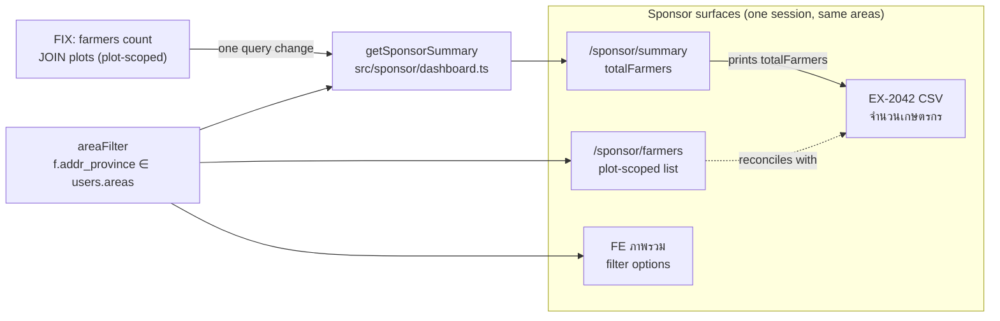

# Design flow — 018-sponsor-csv-farmer-count

One scoping choke point (`areaFilter`); one changed query (`totalFarmers` gains the plot join) makes the summary, the CSV, and the farmers list report the same farmer population. The FE filter needs no change — its options already come from scoped data (verified live 2026-10-13).

Limitation: static Mermaid rendered by the chat client; no interactive Archify renderer installed. The diagram explains; the unit regression test and live API checks enforce.
